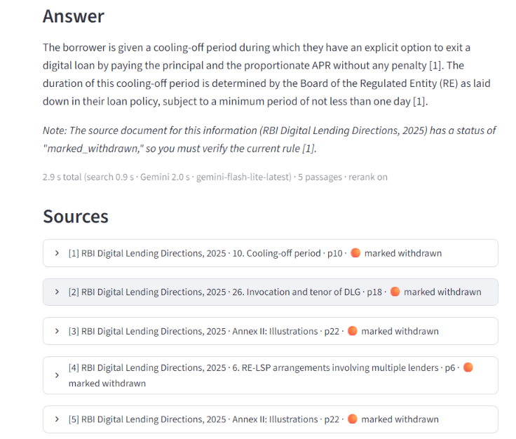
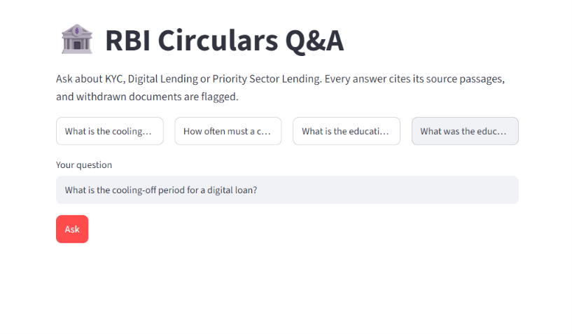
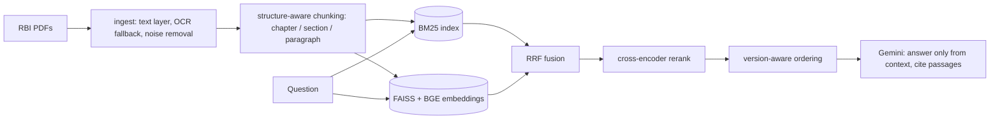

# RBI Circulars Q&A (RAG with citations)

Ask questions about RBI regulations (KYC, Digital Lending, Priority Sector Lending) and get an answer
that **cites the exact passages** it used, and **flags withdrawn documents**.

**Live demo:** https://rbi-circulars-rag.streamlit.app/

_Free-tier note: the app sleeps after 12 hours without visitors and wakes in about a minute. Answers depend on Google's free Gemini quota, so it can occasionally be busy._




## Why this project
Regulatory text is hard for generic RAG: clauses are numbered, old and new versions of the same rule
coexist (PSL 2020 vs 2025), and near-identical documents exist for different bank types (commercial banks vs
small finance banks). The system is built and measured around those problems.

## Results (40 hand-checked questions, 5 documents)

| Configuration | Hit@1 | Hit@3 | Hit@5 | MRR |
|---|---|---|---|---|
| BM25 only | 67.5% | 82.5% | 85.0% | 0.748 |
| Dense only (BGE-small) | 55.0% | 85.0% | 92.5% | 0.709 |
| Hybrid (BM25 + dense, RRF) | 60.0% | 90.0% | 97.5% | 0.755 |
| + cross-encoder reranking | 77.5% | 92.5% | 97.5% | 0.860 |
| + version-aware ordering | **87.5%** | 92.5% | 97.5% | **0.910** |

Hit@k = a gold chunk (right document and the key phrase) is in the top k. MRR = mean reciprocal rank.

**How to read these numbers honestly**
- The 40 questions were written from the documents and checked so each has a gold chunk. Small n: one question = 2.5 points.
- Version-aware ordering was designed after looking at failures on this same set, so its gain may be optimistic.
   No separate held-out set yet. All numbers above are on my own 40 questions, so they may be optimistic. A held-out set is the next step.
- One question (`psl_ibpc_ucb`) was ambiguous in the first run and was reworded to name the 2020 directions.
- Two of the three remaining misses return a chunk that also answers the question (strict single-chunk labels).

## How it works


Design decisions
- **Structure-aware chunking** keeps a clause intact instead of cutting every N characters; each chunk carries a
  `document | chapter | section | para` context line that is embedded with the text.
- **Hybrid search**: embeddings find paraphrases, BM25 finds exact terms ("V-CIP", "DLG").
- **Status metadata**: each document is `active`, `withdrawn` or `marked_withdrawn`; superseded versions are
  pushed down unless the question names the year or asks about the past; answers warn when a source is withdrawn.
- **Grounded prompt**: answer only from numbered passages, cite `[n]`, refuse with a fixed sentence otherwise.
- **Model fallback**: several Gemini models are tried in order with a 45 s timeout (free-tier models were intermittently busy).

## Known limitations (what did not work)
- **Tables** are flattened to text with footnote markers glued on (e.g. the PSL targets table), so a question about
  the agriculture sub-target still misses its gold chunk. Next step: `find_tables` and row-wise chunks.
- Excluding annex chunks changed nothing (tried, no effect).
- No scanned PDFs are in the current corpus: the OCR fallback exists and runs on pages with almost no text layer
  (2 such pages here) but has not been evaluated on real scans.
- Latency, end to end: 9.1 s and 5.7 s on a laptop CPU, 6.5 s and 2.9 s on Streamlit Community Cloud (four measurements, mostly Gemini time).

## Run locally
```bash
python -m venv venv && venv\Scripts\activate          # Windows
python -m pip install -r requirements-pipeline.txt     # app + pipeline libraries
# put your key in .env:  GEMINI_API_KEY=...   and   GEMINI_MODELS=gemini-flash-lite-latest,gemini-3.8-flash
python src/ingest.py && python src/chunk.py && python src/index.py     # rebuild (PDFs go in data/raw_pdfs/)
python eval/run_eval.py --modes hybrid --rerank --prefer-current --label demo   # evaluation
python -m streamlit run app/ui.py
```
The processed data and indexes are committed, so `streamlit run app/ui.py` works right after `pip install -r requirements.txt`.

## Repo layout
`src/` pipeline (ingest, chunk, index, retrieve, answer) · `app/ui.py` Streamlit app · `eval/` questions and runner ·
`data/processed`, `data/index` prebuilt artifacts · `requirements.txt` (app) and `requirements-pipeline.txt` (rebuild + eval).

_Educational project. Not legal advice: verify rules on rbi.org.in. Sources are public RBI documents._
